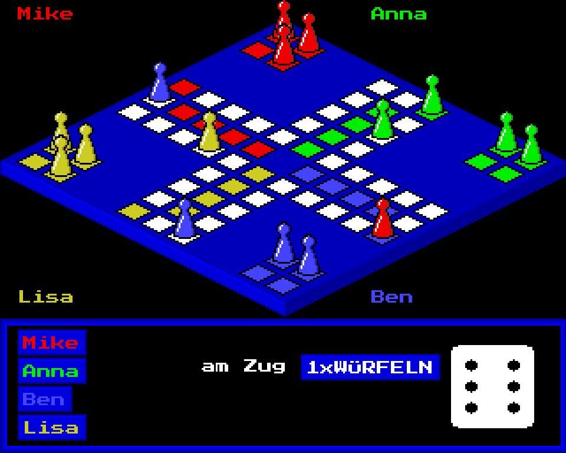

# LUDO – Mensch ärgere dich nicht
written in 1989 by Mike Hesser in GFA-BASIC for the Commodore Amiga

"Mensch ärgere dich nicht" ("Man, don't get angry") is the German version of the classic board game Ludo.
This version from 1989 draws the board in an isometric 3D view, with cone-shaped pieces that are
painted back to front so they overlap correctly. Up to four players can play at the same computer.

The original GFA-BASIC program has now been ported to JavaScript, so the game runs in any web browser.
The port follows the original listing almost line by line: it emulates the Amiga screen (320×256 pixels,
16 colors) and the GFA-BASIC graphics commands, so it looks and plays like it did in 1989.

## How to play

Download or clone the repository and open `index.html` in a web browser. No installation required.

1. On the title screen choose the number of players (1–4) and click `WEITER`.
2. Enter the name of each player and press `Enter`. If you leave a name empty, the player is called "FAULPELZ" (lazybones).
3. The player whose turn it is clicks `WÜRFELN` (or presses `Space`) to roll the die.
4. If more than one piece can move, each one is marked with a small number. Choose a piece with the keys `1`–`4` or click on it.

## Rules

* As long as all your pieces are still at home, you may roll up to three times to get a 6.
* With a 6 you must bring a new piece onto your start field and roll again.
* If you land on a field occupied by an opponent, that piece is sent back home.
* You cannot land on a field occupied by one of your own pieces.
* The goal is to bring all four pieces into your goal fields.

## Changes compared to the original

* You can also roll the die with the space bar and choose pieces with the mouse.
* Finished players get a placement ("1.PLATZ") and the game ends when only one player is left. The original never ended.
* The Amiga Topaz font is replaced by the similar pixel font "Press Start 2P" (loaded from Google Fonts).

## Files

| File | Description |
| --- | --- |
| `index.html` | The browser version (HTML/JavaScript, a single file) |
| `original/MAED.LST` | Original GFA-BASIC source code as plain text (from 22.09.1989) |
| `original/MAED.GFA` | Original GFA-BASIC source code in tokenized GFA format |
| `original/MAED` | Compiled Amiga executable |
