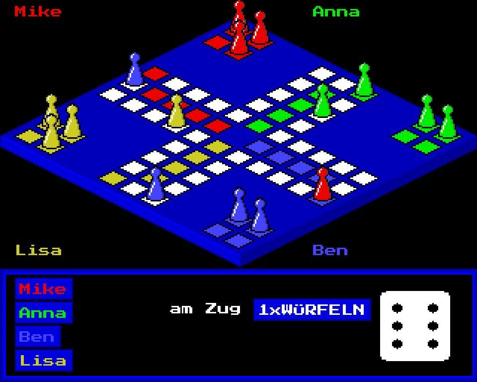

# LUDO – Mensch ärgere dich nicht
geschrieben 1989 von Mike Hesser in GFA-BASIC für den Commodore Amiga

Diese Version des Brettspiel-Klassikers von 1989 zeigt das Spielbrett in isometrischer 3D-Ansicht. Die
kegelförmigen Spielfiguren werden von hinten nach vorne gezeichnet, damit sie sich richtig überdecken.
Bis zu vier Spieler können an einem Computer gegeneinander spielen.

Das originale GFA-BASIC-Programm wurde jetzt nach JavaScript portiert und läuft damit in jedem Webbrowser.
Die Portierung folgt dem Original-Listing fast Zeile für Zeile: Sie bildet den Amiga-Bildschirm (320×256 Pixel,
16 Farben) und die GFA-BASIC-Grafikbefehle nach, sodass das Spiel aussieht und sich spielt wie 1989.

## Spielen

Repository herunterladen oder klonen und `index.html` im Webbrowser öffnen. Keine Installation nötig.

1. Im Titelbild die Anzahl der Spieler (1–4) wählen und auf `WEITER` klicken.
2. Die Namen der Spieler eingeben und mit `Enter` bestätigen. Wer keinen Namen eingibt, heißt „FAULPELZ“.
3. Wer am Zug ist, klickt auf `WÜRFELN` (oder drückt die `Leertaste`).
4. Können mehrere Kegel ziehen, sind sie mit kleinen Ziffern markiert. Auswahl mit den Tasten `1`–`4` oder per Klick auf den Kegel.

## Regeln

* Solange alle eigenen Kegel im Haus stehen, darf man bis zu dreimal würfeln, um eine 6 zu bekommen.
* Mit einer 6 muss ein neuer Kegel auf das Startfeld, danach wird noch einmal gewürfelt.
* Wer auf ein Feld mit einem gegnerischen Kegel kommt, schickt diesen zurück ins Haus.
* Auf ein Feld mit einem eigenen Kegel darf man nicht ziehen.
* Ziel ist es, alle vier Kegel in die eigenen Zielfelder zu bringen.

## Änderungen gegenüber dem Original

* Würfeln geht zusätzlich mit der Leertaste, Kegel lassen sich auch mit der Maus wählen.
* Fertige Spieler bekommen eine Platzierung („1.PLATZ“), und das Spiel endet, wenn nur noch ein Spieler übrig ist. Das Original lief endlos weiter.
* Der Amiga-Font Topaz wird durch den ähnlichen Pixelfont „Press Start 2P“ (von Google Fonts) ersetzt.

## Dateien

| Datei | Beschreibung |
| --- | --- |
| `index.html` | Die Browser-Version (HTML/JavaScript, eine einzige Datei) |
| `original/MAED.LST` | Originaler GFA-BASIC-Quelltext als Text (vom 22.09.1989) |
| `original/MAED.GFA` | Originaler GFA-BASIC-Quelltext im tokenisierten GFA-Format |
| `original/MAED` | Kompiliertes Amiga-Programm |
